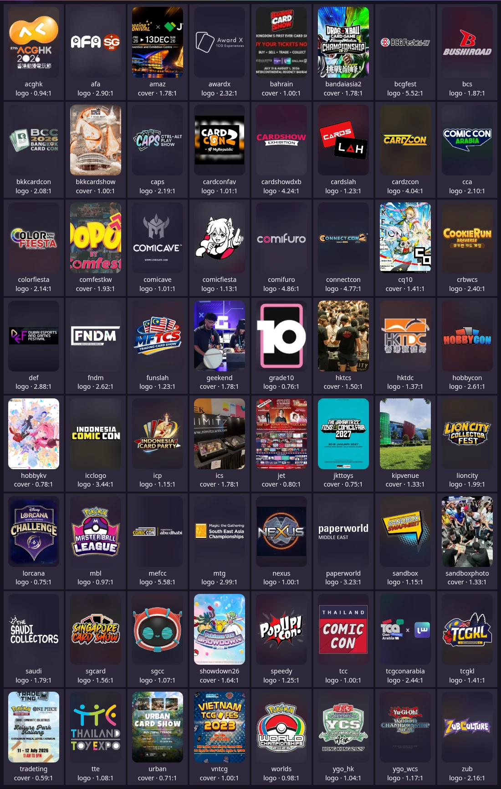

# Event artwork audit

The built planner renders 46 files as contained logos and 18 as edge-to-edge posters or photos. The original export had flattened all 64 into 96 × 96 squares. The replacement WebPs use the matching original artwork, with exterior padding and neutral mattes removed from logos. The monochrome AWARD X mark uses light ink on the dark backdrop.

Chrome checks covered Grid, Rows, event pages, Top picks, Pipeline and Calendar at 390px and 1440px in both themes. AWARD X and MTG use 108px of the 112px mobile column and 172px of the 176px desktop column. Delayed image loads preserved the measured layouts in all six views. All 31 generated titles fit, and the lowest sampled cover-text contrast against the rendered patterns was 6.82:1.

Dimensions below describe the shipped WebPs. The four corrected logo decisions are ACGHK, Lorcana Challenge, Thailand Toy Expo and Yu-Gi-Oh! World Championship.

| File | Fit | Pixels | Width / height |
| --- | --- | ---: | ---: |
| acghk.webp | logo | 724 × 772 | 0.94 |
| afa.webp | logo | 200 × 69 | 2.90 |
| amaz.webp | cover | 600 × 338 | 1.78 |
| awardx.webp | logo | 172 × 74 | 2.32 |
| bahrain.webp | cover | 100 × 100 | 1.00 |
| bandaiasia2.webp | cover | 768 × 432 | 1.78 |
| bcgfest.webp | logo | 381 × 69 | 5.52 |
| bcs.webp | logo | 161 × 86 | 1.87 |
| bkkcardcon.webp | logo | 560 × 269 | 2.08 |
| bkkcardshow.webp | cover | 768 × 768 | 1.00 |
| caps.webp | logo | 184 × 84 | 2.19 |
| cardconfav.webp | logo | 575 × 571 | 1.01 |
| cardshowdxb.webp | logo | 768 × 181 | 4.24 |
| cardslah.webp | logo | 772 × 627 | 1.23 |
| cardzcon.webp | logo | 400 × 99 | 4.04 |
| cca.webp | logo | 174 × 83 | 2.10 |
| colorfiesta.webp | logo | 772 × 360 | 2.14 |
| comfestkw.webp | cover | 768 × 397 | 1.93 |
| comicave.webp | logo | 175 × 174 | 1.01 |
| comicfiesta.webp | logo | 249 × 221 | 1.13 |
| comifuro.webp | logo | 238 × 49 | 4.86 |
| connectcon.webp | logo | 630 × 132 | 4.77 |
| cq10.webp | cover | 768 × 543 | 1.41 |
| crbwcs.webp | logo | 754 × 314 | 2.40 |
| def.webp | logo | 256 × 89 | 2.88 |
| fndm.webp | logo | 199 × 76 | 2.62 |
| funslah.webp | logo | 196 × 159 | 1.23 |
| geekend.webp | cover | 768 × 432 | 1.78 |
| grade10.webp | logo | 104 × 136 | 0.76 |
| hktcs.webp | cover | 400 × 267 | 1.50 |
| hktdc.webp | logo | 89 × 65 | 1.37 |
| hobbycon.webp | logo | 772 × 296 | 2.61 |
| hobbykv.webp | cover | 598 × 768 | 0.78 |
| icclogo.webp | logo | 227 × 66 | 3.44 |
| icp.webp | logo | 240 × 208 | 1.15 |
| ics.webp | cover | 768 × 432 | 1.78 |
| jet.webp | cover | 614 × 768 | 0.80 |
| jkttoys.webp | cover | 576 × 768 | 0.75 |
| kipvenue.webp | cover | 768 × 576 | 1.33 |
| lioncity.webp | logo | 165 × 83 | 1.99 |
| lorcana.webp | logo | 578 × 768 | 0.75 |
| mbl.webp | logo | 297 × 306 | 0.97 |
| mefcc.webp | logo | 446 × 80 | 5.58 |
| mtg.webp | logo | 768 × 257 | 2.99 |
| nexus.webp | logo | 192 × 192 | 1.00 |
| paperworld.webp | logo | 400 × 124 | 3.23 |
| sandbox.webp | logo | 284 × 247 | 1.15 |
| sandboxphoto.webp | cover | 300 × 225 | 1.33 |
| saudi.webp | logo | 768 × 430 | 1.79 |
| sgcard.webp | logo | 165 × 106 | 1.56 |
| sgcc.webp | logo | 196 × 184 | 1.07 |
| showdown26.webp | cover | 768 × 467 | 1.64 |
| speedy.webp | logo | 324 × 260 | 1.25 |
| tcc.webp | logo | 145 × 145 | 1.00 |
| tcgconarabia.webp | logo | 772 × 316 | 2.44 |
| tcgkl.webp | logo | 256 × 182 | 1.41 |
| tradeting.webp | cover | 454 × 768 | 0.59 |
| tte.webp | logo | 768 × 712 | 1.08 |
| urban.webp | cover | 545 × 768 | 0.71 |
| vntcg.webp | cover | 500 × 500 | 1.00 |
| worlds.webp | logo | 751 × 768 | 0.98 |
| ygo_hk.webp | logo | 289 × 278 | 1.04 |
| ygo_wcs.webp | logo | 569 × 485 | 1.17 |
| zub.webp | logo | 768 × 356 | 2.16 |
